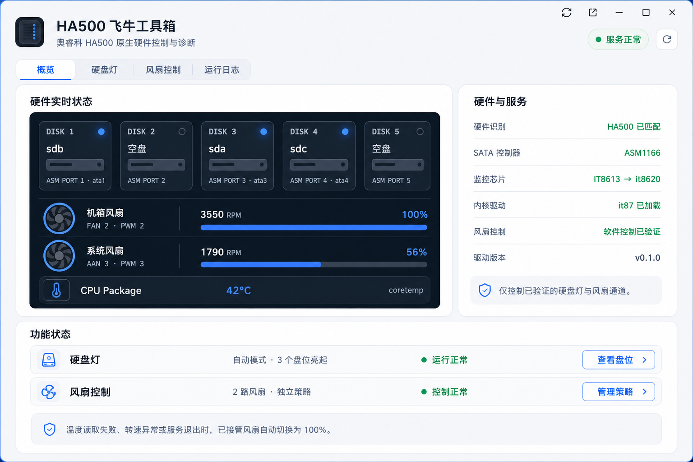
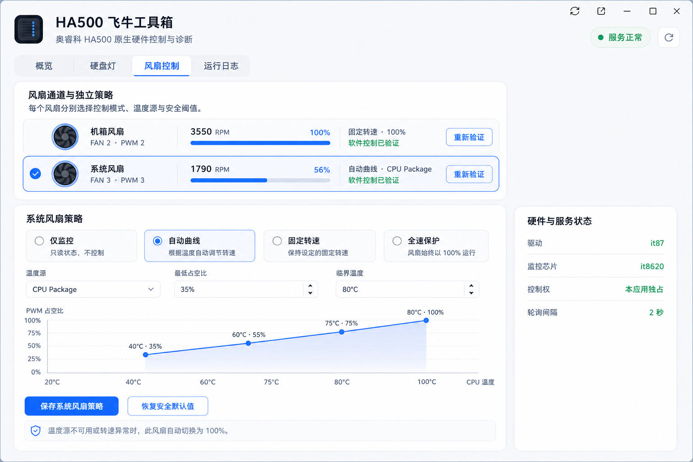

# 原生界面设计规范

## 信息架构

顶部固定显示应用图标、`HA500 飞牛工具箱`、副标题、服务状态和刷新按钮。主导航包含：

1. 概览
2. 硬盘灯
3. 风扇控制
4. 运行日志

概览稿：

风扇独立策略稿：

硬盘灯现有界面参考：

概念稿仅用于布局和视觉方向。实际实现必须修正生成图中的错误文案，例如 `AAN 3` 应为 `FAN 3`；曲线图横轴必须是 CPU 温度、纵轴必须是 PWM 占空比。

## 视觉基线

- 页面背景：`#f5f7fb`
- 主卡片：白色，1px `#e3e9f2` 边框，14～18px 圆角
- 硬件状态面板：深色 `#0d1b2a`，次级文字 `#a8b7ca`
- 主色：`#2f73ff`
- 成功色：`#16a36a`
- 警告色：`#d97706`
- 危险色：`#d9363e`
- 正文字体：fnOS 系统字体栈，不加载外部字体
- 交互控件最小高度 36px；主要操作 40px；焦点环清晰可见

## 概览

左侧主卡显示五个物理盘位、已识别风扇和 CPU Package 温度；右侧卡片显示：

- HA500 硬件匹配结果
- ASM1166 控制器
- IT8613 强制识别为 it8620 的驱动状态（仅在实际检测成立时展示）
- `it87` 模块状态
- 软件控制验证状态
- 应用版本

底部以功能行汇总硬盘灯模式和风扇通道数。未通过验证时必须使用“只读/未验证”文案，不得显示“控制正常”。

## 硬盘灯

迁移现有五盘位可视化，保留自动模式和手动模式。新增“端口映射”区域：

- 五个盘位分别选择 ASM1166 的 1～6 号端口。
- 五项必须互不重复。
- 显示每个端口当前识别到的块设备和型号，但不显示明文序列号。风扇温度源以下拉项显示盘位、型号、派生硬盘 ID 和当前 SMART 温度。
- 保存前给出映射预览；保存后立即回到自动状态刷新灯光。

## 风扇控制

顶部通道列表每行显示物理名称、`FAN N / PWM N`、RPM、占空比、当前策略和验证状态。选中一行后，下方只编辑该通道：

- 模式：仅监控、自动曲线、固定转速、全速保护
- 温度源
- 最低占空比
- 临界温度
- 曲线节点或固定占空比
- `重新验证` 与 `保存该风扇策略`

不同风扇的表单状态必须独立；切换通道前若有未保存内容，应提示保存或放弃。启用写控制时显示冲突服务检测结果和安全确认。

## 运行日志

- 默认显示最近 500 行并支持自动刷新。
- 提供“下载诊断”和“一键清空日志”。清空需二次确认。
- 页面说明日志会自动轮转，并显示当前文件大小与保留数量。
- 错误信息应包含发生时间、组件、通道和可行动建议，不输出敏感信息。

## 响应式和可访问性

- 宽度大于 1100px 时采用主内容 + 状态侧栏。
- 720～1100px 时状态侧栏移到主卡下方。
- 小于 720px 时卡片单列、导航横向滚动，表格转为卡片列表。
- 所有状态同时提供文字和颜色，不只依赖颜色。
- 自定义单选、开关和曲线节点必须支持键盘操作并带有明确标签。
